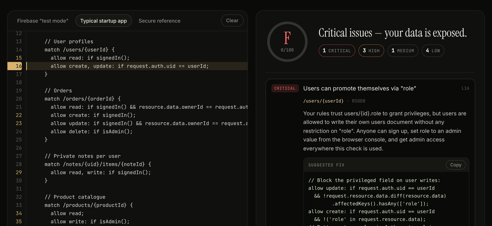

<div align="center">

# RuleSight

**Find the holes in your Firestore security rules — before someone else does.**

Paste your `firestore.rules` and get a security score, plain-language explanations and ready-to-paste fixes.
Runs 100% in the browser: your rules never leave the page.

[**Try it live →**](https://kaerlix-maker.github.io/rulesight/)



</div>

## Why

Every Firebase app ships its config inside the client code, so **your security rules are the only thing standing between your database and the internet.** The most common mistakes are easy to make and easy to miss:

- leaving the console's *test mode* on,
- treating "signed in" as if it meant "allowed",
- forgetting to compare `{userId}` with the caller,
- letting users write the `role` field that your rules trust.

RuleSight catches these in seconds and tells you exactly how to fix them.

## What it checks

| ID | Severity | Check |
|----|----------|-------|
| RS001 | critical → low | Public access (`allow read;`, `if true`). Public **writes** or a public catch-all are critical; public reads are rated by how sensitive the collection looks. |
| RS002 | critical / high | Firebase *test mode* rules (`request.time < timestamp.date(...)`), active or expired. |
| RS003 | critical | Recursive wildcard `{document=**}` open to any signed-in user. |
| RS004 | high | Per-user path (`{userId}`, `{uid}`…) without an ownership check. |
| RS005 | high → low | "Signed in" used as the only access rule. |
| RS006 | medium | Owner field checked on the old document but not locked on update. |
| RS007 | high | `create` doesn't enforce the owner field → documents created in someone else's name. |
| RS008 | critical | **Privilege escalation:** rules trust `users/{id}.role`, but users can write that field themselves. |
| RS009 | low | Writes without any validation of the incoming data. |
| RS010 | low | `rules_version` missing or not `'2'`. |

User-defined `function`s are inlined before analysis, so checks see through helpers like `isOwner(uid)`.

## Command line & CI

```bash
npx rulesight firestore.rules                  # human-readable report
npx rulesight firestore.rules --json           # machine-readable
npx rulesight firestore.rules --fail-on=medium # exit 1 on medium or worse (default: high)
```

Add it to GitHub Actions to block insecure rules before they're deployed:

```yaml
- run: npx rulesight firestore.rules
```

## How it works

```
src/core/parser.ts   → comments stripped (line numbers kept), match blocks walked
                       with a path stack, allow statements + conditions extracted,
                       functions inlined
src/core/analyze.ts  → each rule runs through independent checks; findings are
                       de-duplicated, sorted and turned into a 0–100 score
src/App.tsx          → React UI (live analysis, click a finding to jump to the line)
src/cli.ts           → Node CLI, bundled with esbuild
```

The core has **zero runtime dependencies** and is fully covered by tests (`npm test`).

## Develop

```bash
npm install
npm run dev        # web app on localhost
npm test           # vitest
npm run build      # production build → dist/
npm run build:cli  # CLI → cli/rulesight.js
```

## Limits

RuleSight is a static analyzer. It finds common, high-impact mistakes; it does not execute your rules or replace the official [Firebase Rules emulator tests](https://firebase.google.com/docs/rules/unit-tests) or a full security review. Cloud Storage rules are not supported yet.

## License

MIT © [Kaerlix](https://github.com/kaerlix-maker)
